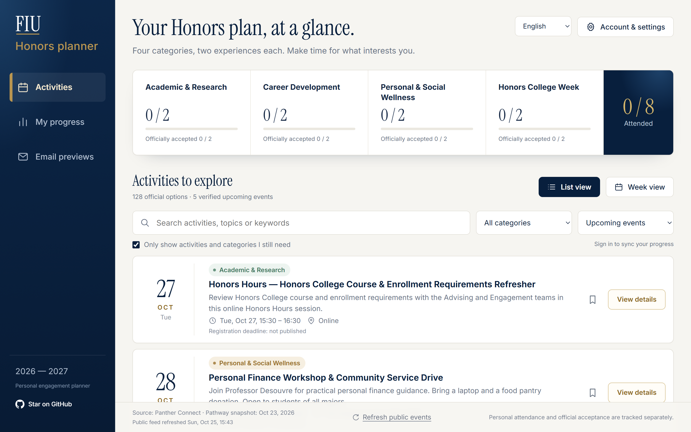

# FIU Honors Planner

Plan and track your FIU Honors College engagement pathway for 2026–2027: all 128 official options, the verified events behind them, your progress toward two experiences in each of four categories, and reminder emails you review before anything is sent.

**Live site: <https://fiu-honors-planner.vercel.app/>**



## What it does

- **Every official option in one place.** All 128 pathway options across Academic & Research, Career Development, Personal & Social Wellness, and Honors College Week, captured from the Panther Connect pathway on October 23, 2026, each with its official description and a link to the source page.
- **Verified events, not guesses.** Scheduled events are kept apart from self-reported experiences, undated opportunities, and recurring series. Each event shows its New York time, weekday, and location, and says plainly when the registration deadline is not published.
- **Recommendations that respect the rules.** The list defaults to activities that still count toward a category you have not finished. One event never counts twice, and a cross-category event fills only one remaining slot.
- **Private progress, synced across devices.** Sign in with a six-digit email code. Your planned, attended, and officially accepted records, notes, verified deadlines, and volunteer hours are stored to your account and available wherever you sign in.
- **Week view.** A seven-day calendar of the filtered events with previous and next week navigation.
- **Reminders you approve.** A weekly digest of the next seven days and a reminder five calendar days before each known registration deadline. You see the full recipient, subject, and body, and download an `.eml` draft. Nothing is sent automatically.
- **Honest data freshness.** The public FIU events feed refreshes daily and on demand, and the last successful refresh time is always visible. The signed-in pathway directory is a dated snapshot and is labeled as one.
- **Interface in English or Chinese.** Guests start in English. The header switches languages, and signed-in accounts remember the choice.

## How to use it

1. **Open** <https://fiu-honors-planner.vercel.app/>. Browsing needs no account.
2. **Browse and filter.** Search by keyword, pick a category, and choose a time filter: upcoming events, all 128 options, self-scheduled experiences, undated, or past. Switch between list view and week view, or click a progress column to jump to that category.
3. **Sign in.** Open *Account & settings*, enter your email, and type the six-digit code you receive. The first successful code creates your account.
4. **Plan and record.** Click the bookmark on a row to mark it as planned, or open *View details* to set the status (planned, attended, officially accepted, not interested), the attendance date, a verified registration deadline, and notes.
5. **Track the four categories.** The progress band shows attended and officially accepted counts per category and your total out of 8. *My progress* lists your records and holds the separate 20 annual volunteer service hours.
6. **Review reminders.** *Email previews* shows the weekly digest and the five-day deadline reminders generated from your progress. Adjust preferences in settings and download a draft when you want to send one yourself.
7. **Back up.** Export your records as JSON and restore them later into the same account.

Official reporting still happens in Panther Connect and GivePulse. The planner never logs into FIU, stores FIU credentials, RSVPs, or submits experiences on your behalf.

## Development

Next.js 16 on Vercel, Neon Postgres, and managed Neon Auth. Production runs on Node 24.

```sh
npm ci
vercel link
vercel env pull .env.local
npm run dev
```

Required server variables: `DATABASE_URL`, `NEON_AUTH_BASE_URL`, `NEON_AUTH_COOKIE_SECRET`, `CRON_SECRET`. Keep them in the ignored `.env.local` and in encrypted Vercel environment variables. The production origin must stay trusted in Neon Auth; sign-in uses managed Email OTP only, and password routes are disabled.

### Verify

```sh
npm test
npm run typecheck
npm run build
node --env-file=.env.local scripts/check-db.mjs
node scripts/check-auth.mjs http://localhost:3000
```

The database check uses disposable user IDs and removes its rows. The auth smoke check never sends email or creates an account. `docs/verification.md` keeps the verification ledger.

### Data and refresh

- `data/items.json` holds the 128 options (33 / 41 / 36 / 18 per category) with their original descriptions; `docs/sources/` keeps the capture. Import a new authorized capture with `node scripts/import-source.mjs <capture.json>`.
- The refresh button and the daily 13:00 UTC Vercel Cron fetch `https://fiu.campuslabs.com/engage/events.rss`, update known event IDs and exact catalog-title matches, and keep the last verified snapshot on failure. A title match alone is not Honors credit until verified.
- Official pathway deadline: April 9, 2027 at 23:59 (the source labels it EST). All wall-clock values use America/New_York, including DST validation.

### Privacy

All private reads and writes are scoped to the authenticated, verified Neon user ID. Clients cannot choose a data owner or reminder recipient, writes carry the displayed account email so a stale tab cannot save into another account, and sign-out clears private state across tabs. No runtime LLM or translation API is called.

### Design

Navy sidebar, warm paper surface, white cards, gold accents. Instrument Serif carries the headings and numerals, Inter the interface. Motion is purposeful: one authored entrance, View Transitions between pages, and layered hover and press feedback, all collapsing to instant under `prefers-reduced-motion`. See `docs/design.md`.

---

## 中文

规划并跟踪你在 FIU Honors College 2026–2027 参与路径上的进度：全部 128 个官方选项、背后已核实的活动、"四个分类各完成两项经历"的个人进度，以及发送前先由你审核的提醒邮件。

**网站：<https://fiu-honors-planner.vercel.app/>**（页眉可切换中文界面）

**功能**

- 128 个官方选项按四个分类整理，保留官方说明与原页面链接，中文界面下显示整理好的中文摘要。
- 已排期活动与自行安排的经历、未公布日期的机会分开显示；时间按纽约时区，报名截止未公布时如实标注。
- 推荐只显示仍能计入未完成分类的活动，一场活动不重复计数。
- 邮箱六位验证码登录，计划 / 已参加 / 学校已认可记录、备注、志愿服务小时云端同步。
- 周视图；每周清单与截止前 5 天提醒的邮件预览，可下载 `.eml` 草稿，绝不自动发送。
- 公开活动源每日刷新并显示最近成功时间；需登录的路径目录为带日期的快照。

**使用**：打开网站浏览活动 → 搜索与筛选 → 在"同步与设置"用邮箱验证码登录 → 用书签或"查看详情"记录计划与参与状态 → 在"我的进度"查看四类进度和志愿小时 → 在"邮件预览"审核提醒草稿。向学校的正式上报仍在 Panther Connect 与 GivePulse 完成；本工具不会登录 FIU 系统或保存 FIU 凭据。

本地运行与验证命令见上方 *Development*。
